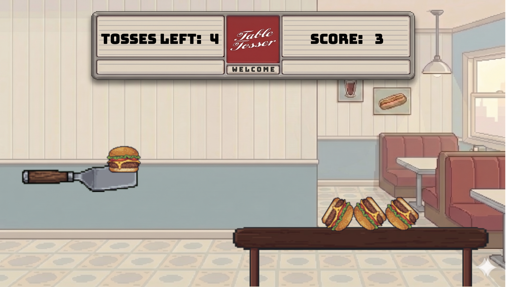

# Table Tossin'

[Live App][live]

[live]: https://tabletossin.vercel.app

Table Tossin' (page title "Table Toss") is a browser-based physics game built with [Matter.js][matter]. Wind up the spatula, launch food off it, and try to land your tosses on the diner table for points.

[matter]: http://brm.io/matter-js/



### Technologies

This game utilizes vanilla JS for all game logic and Matter.js for rendering and physics. There is no build system — the game runs by opening `index.html` directly in a browser. The only npm dependency (`@neondatabase/serverless`) is for the leaderboard's Vercel serverless functions in `api/`, not the game itself.

## Playing

The game is a four-level run, one object per level, played in order:

1. Hamburger
2. Fish
3. Duck
4. Toy Boat

Each object has its own weight, friction, and bounciness, so they fly and settle differently. You get **7 tosses per level**, and your total score carries across all four levels.

To launch, pull back the spatula-shaped whacker and release:

- **Desktop:** hold the spacebar to wind the whacker back, then release to fire.
- **Mobile:** tap and hold anywhere on the play area to pull back, then let go to fire.

The whacker is a single damped spring pivoted at its left end. Holding input slides the spring's anchor back to build tension; releasing snaps the anchor to rest and the spring whips the whacker forward.

Your level score is the number of objects that come to rest on the table (in the column above it) — pieces still in flight or that have fallen off don't count. After the last toss, once everything has settled, the level ends and you move on to the next one.

## Bonus mode

If **5 or more objects are scoring** when a level's round ends, you enter bonus mode (a perfect round isn't required). The camera zooms out to keep your stack in frame and you get timed bonus shots — a new one every couple of seconds, with a countdown in the HUD. Keep tossing for as long as you can; the bonus ends the moment an object falls off the table, and your score is banked.

## Leaderboard

The top 10 runs are kept on a leaderboard, shown on the game-complete screen and from the title screen. If your total makes the cut, enter arcade-style initials (letters and digits, up to 3 characters).

Scores are server-backed through the serverless functions in `api/`. If the server isn't reachable (offline, opened from `file://`, or the backend is down), the leaderboard silently falls back to a list in `localStorage` and everything else works as usual.

## Running locally

Open `index.html` in a browser. To use a local server instead:

```
npx serve .
# or
python3 -m http.server
```

To also run the `api/` leaderboard functions locally, use the Vercel CLI (the functions read `DATABASE_URL`):

```
vercel dev
```

All game logic lives in `lib/hamhuckin.js`. The project was renamed to Table Tossin', but that file (and the repo directory) kept its historical `hamhuckin` name. See `CLAUDE.md` for architecture notes.
